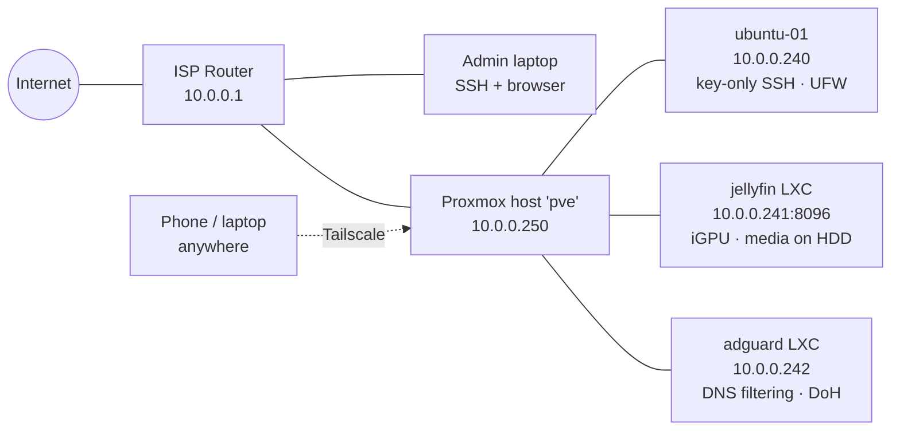

# HomeLab

A self-built Proxmox homelab I use as hands-on training for **CompTIA A+, Network+, Linux+, Security+** and **AWS**, and as the foundation for real services at home (media, DNS filtering, remote access, IoT).

Every project is documented as a **camp**: goal, build steps, verification, troubleshooting log, and lessons learned.

---

## Hardware

| Device | Role | Specs |
|---|---|---|
| Dell OptiPlex 5050 SFF | Proxmox VE host | Intel i5-6500 (4C, VT-x/VT-d, QuickSync), 16 GB DDR4 |
| ↳ 256 GB Samsung NVMe | Host OS + VM/container disks (`local-lvm`) | Fast tier |
| ↳ 1 TB Toshiba HDD | ISOs, templates, backups, media (`hdd-storage`) | Capacity tier, S.M.A.R.T. verified |
| Cisco managed switch | VLAN lab (future camp) | Held until segmentation phase |

## Network

| Host | IP | Purpose |
|---|---|---|
| Router / gateway | `10.0.0.1` | ISP gateway, DHCP |
| `pve` | `10.0.0.250` (static) | Proxmox host, web UI on `:8006`, Tailscale subnet router |
| `ubuntu-01` (VM 100) | `10.0.0.240` (static) | Hardened Linux server |
| `jellyfin` (CT 101) | `10.0.0.241` (static) | Jellyfin media server, `:8096` |
| `adguard` (CT 102) | `10.0.0.242` (static) | AdGuard Home DNS filtering, `:53` / `:80` |
| Reserved for VMs/containers | `10.0.0.240–.249` | |

**Security posture:** no ports forwarded, no DMZ. Remote access runs over Tailscale (WireGuard): `pve` acts as a subnet router for `10.0.0.0/24`, gated by GitHub SSO with MFA. Services bind to their LAN addresses only. Tailscale pushes AdGuard as DNS to my devices, so they get filtering anywhere without touching the household network.

---

## Camps

| # | Camp | Status | Key skills | Write-up |
|---|---|---|---|---|
| 1 | Proxmox foundation | ✅ Done | BIOS/UEFI, hypervisor install, static IP, apt repos, tiered storage, S.M.A.R.T. | [camp-1-proxmox.md](camp-1-proxmox.md) |
| 2A | First Linux VM | ✅ Done | VM sizing, Ubuntu Server install, SSH, LVM online resize, guest agent, snapshots | [camp-2-session-a.md](camp-2-session-a.md) |
| 2B/C | Static IP + hardening | ✅ Done | netplan, ed25519 keys, password/root login disabled, UFW default-deny, auto-patching | [camp-2-sessions-b-c.md](camp-2-sessions-b-c.md) |
| 3 | Tailscale remote access | ✅ Done | WireGuard mesh VPN, subnet router, IP forwarding, SSO + MFA, zero open ports | [camp-3-tailscale.md](camp-3-tailscale.md) |
| 4 | Jellyfin media server | ✅ Done | Unprivileged LXC, bind mounts, iGPU passthrough, QuickSync transcoding, DNS troubleshooting | [camp-4-jellyfin.md](camp-4-jellyfin.md) |
| 5 | AdGuard Home | ✅ Done | DNS filtering, DoH, LAN-only binding, Tailscale split DNS, CLI container builds, staged rollout | [camp-5-adguard.md](camp-5-adguard.md) |
| 6 | Home Assistant | ⏳ Next | IoT integration | — |
| 7 | Backups + Immich | Planned | Backup strategy, retention, thin pool monitoring, self-hosted photos | — |
| 8 | Docker host | Planned | Containers, app hosting | — |
| 9 | Cisco switch + VLANs | Planned | Segmentation, 802.1Q, inter-VLAN firewalling | — |
| 10 | AWS hybrid | Planned | Cloud + on-prem integration | — |

### Ops / Maintenance

| Date | Task | Write-up |
|---|---|---|
| 2026-10-28 | Host recovery, new admin workstation, maintenance | [ops-2026-10-28-recovery-and-maintenance.md](ops-2026-10-28-recovery-and-maintenance.md) |
| 2026-10-30 | SSH key rotation + retired device revocation | [ops-ssh-key-rotation.md](ops-ssh-key-rotation.md) |

Quick command reference: [cheatsheet.md](cheatsheet.md)

---

## Highlights

- **Verify before acting:** SHA-256 checksums on every ISO and installer script; caught a wrong-architecture (ARM64) download before flashing.
- **Change safely:** snapshots before risky changes; `netplan try` auto-rollback; `sshd -t` before restarting SSH; config backups before edits; staged rollouts with a written rollback.
- **Troubleshoot, don't reinstall:** isolated issues layer by layer, including a USB-blocking antivirus driver, inherited Tailscale DNS breaking a container, a paused terminal (XOFF) stalling `apt`, and Windows NRPT making `nslookup` disagree with real apps.
- **Least privilege + small attack surface:** key-only SSH, no root password login, default-deny firewall, unprivileged containers, services bound to LAN addresses only, zero open router ports.

## Lessons Learned

- Read the config before you edit it. Filenames and defaults aren't always what you expect.
- A passing test can pass for the wrong reason (e.g., `ping` succeeding over IPv6, not IPv4). Check *which path* it took.
- Always check the prompt: `PS C:\` is the laptop, `root@pve` is the host, `root@jellyfin` is a container.
- Change → verify. "I updated it" means nothing until the output proves it.
- When something breaks, ask what changed recently, even somewhere else.

---

*Built alongside a B.S. in Cloud & Network Engineering (AWS track) at WGU.*
